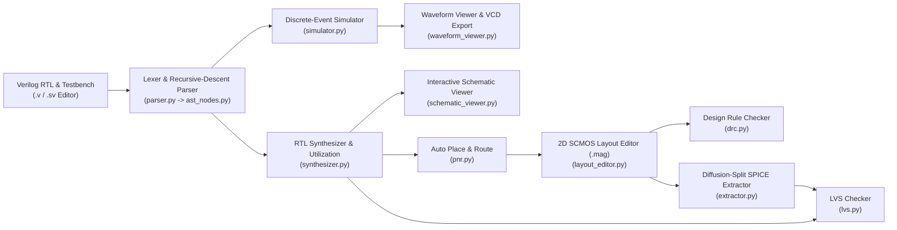

# SiliconForge VLSI Studio

**SiliconForge VLSI Studio** is a self-contained educational VLSI Electronic Design Automation (EDA) desktop suite for Windows built with Python and **PySide6**. It unifies the core workflows of **ModelSim** (RTL simulation & waveforms), **Vivado** (RTL synthesis, schematic & resource utilization), and **Magic VLSI** (2D SCMOS layout editing, automatic Place & Route, DRC, LVS, and SPICE extraction) inside a single native desktop application—requiring zero external EDA installations or licenses.

---

## Table of Contents

- [Key Features](#key-features)
- [System Architecture](#system-architecture)
- [System Design](#system-design)
- [Project Structure](#project-structure)
- [Installation Process](#installation-process)
- [Quick Start & Usage](#quick-start--usage)
- [Running Tests](#running-tests)

---

## Key Features

### 1. RTL Design & ModelSim-Style Discrete-Event Simulation
- **Verilog-2001 / SystemVerilog Subset Editor (`rtl_editor.py`):** Syntax highlighting, exact 1:1 line-number gutter, active-line highlighting, and red inline error-line jumping on syntax errors.
- **Self-Contained Parser & Simulator (`parser.py`, `simulator.py`):**
  - Supports `module ... endmodule`, hierarchical module instantiation, `assign`, `always @(posedge/negedge/level)`, `always_comb`, `always_ff`, `always #delay`, `initial`, `case`/`casez`/`casex`, `if/else`, `for`, `while`, `repeat`, `forever`, gate primitives, replications (`{N{x}}`), concatenations, part-selects (`+:`/`-:`), `` `define `` macros, `(* ... *)` attributes, `$display`, `$monitor`, `$time`, and `$finish`.
  - Automatically generates clock/reset/data input stimulus when simulating a standalone design module without a testbench.
- **Interactive Waveform Viewer (`waveform_viewer.py`):** Zoom/pan timeline, Hex/Bin/Dec radix switching, yellow measurement cursor, and IEEE 1364 `.vcd` export.

### 2. Vivado-Style RTL Synthesis & Schematic Viewer
- **RTL Elaboration & Synthesis (`synthesizer.py`):** Converts parsed `ModuleDef` ASTs into a gate/RTL `Netlist` (`INPUT`, `OUTPUT`, `DFF`, `MUX`, `ADD`, `SUB`, `CMP`, `AND`, `OR`, `NAND`, `NOR`, `XOR`, `XNOR`, `NOT`, `BUF`, `CONST`).
- **Interactive Schematic & Utilization Report (`schematic_viewer.py`):** Topological left-to-right `QGraphicsView` schematic with cubic Bezier signal routing and a live Resource Utilization table (Bonded IOBs, LUTs/Gates, Flip-Flops, Adders, Muxes, Logic Depth, and per-cell breakdown).

### 3. Magic-Style Physical Layout, Auto PnR, DRC, LVS & SPICE Extraction
- **2D SCMOS Lambda ($\lambda$) Layout Editor (`layout_editor.py`, `layers.py`):** Interactive grid canvas with `nwell`, `pwell`, `ndiff`, `pdiff`, `poly`, `metal1`, `metal2`, `contact`, and `via` layers, Paint/Erase/Label/Pan tools, visibility toggles, and authentic Magic `.mag` import/export (`mag_io.py`).
- **Automatic RTL-to-Layout Place & Route (`pnr.py`):** Generates a DRC-clean & LVS-clean SCMOS standard-cell layout directly from any synthesized Verilog module, mapping logic gates and flip-flops to multi-pin CMOS cells and routing nets across a `metal2` + `via` channel.
- **Design Rule Checker (`drc.py`):** Checks minimum width, exact contact/via dimensions (`2x2λ`), same-layer minimum spacing, and `1λ` Metal1/Metal2/active/poly enclosures with red hatched violation overlays.
- **Layout vs. Schematic (`lvs.py`):** Verifies electrical isolation (detecting `VDD`↔`GND` and signal-net shorts), power rail presence, NMOS/PMOS/total MOSFET count matching against the synthesized schematic, and I/O pin label matching.
- **SPICE Netlist Extractor (`extractor.py`):** Splits diffusions across intersecting polysilicon gates into true Source/Drain islands, runs Union-Find connectivity across contacts/vias, and outputs `.subckt` SPICE netlists.

### 4. Unified Desktop IDE & Windows Installer
- **Integrated Workbench (`main_window.py`):** Project & Flow Navigator, universal `.v`/`.sv` file open/save (`Ctrl+O`, `Ctrl+S`), blank Verilog scratchpad (`Ctrl+N`), interactive permission prompts before Simulation/Synthesis/Layout Generation, Tcl-style command console (`sim`, `synth`, `genlayout`, `drc`, `lvs`, `extract`, `clear`, `help`), and built-in demos (`FullAdder_Demo`, `Counter4_Demo`, `CPU4_Demo`).

---

## System Architecture



---

## System Design

| Subsystem | Module(s) | Core Design Pattern & Responsibility |
| :--- | :--- | :--- |
| **Verilog Front-End** | `vlsi_studio/verilog/ast_nodes.py`, `parser.py` | Line-preserving preprocessor (`define` expansion & directive stripping), regex tokenizer, and precedence-climbing recursive-descent parser producing `ModuleDef` ASTs with exact 1-based `VerilogSyntaxError.line` tracking. |
| **Simulation Engine** | `vlsi_studio/verilog/simulator.py` | Min-heap priority queue `(time, seq_id, callback)` discrete-event kernel with continuation-based timed statement execution (`_run_timed_stmt`), delta-cycle combinational settling, edge-triggered non-blocking (`<=`) register updates, and `WaveTrace` VCD serialization. |
| **Synthesis Engine** | `vlsi_studio/synth/synthesizer.py` | AST-to-DAG elaboration merging per-register `if/else`/`case` branches into `MUX` → `DFF` chains, longest-path topological column layering, and hardware resource estimation. |
| **Physical Layout & PnR** | `vlsi_studio/layout/layers.py`, `pnr.py`, `mag_io.py`, `presets.py` | Integer $\lambda$-grid rectangle model with SCMOS design rules, multi-pin standard-cell generator (`cell_finger_count`), conflict-free horizontal `metal2` / vertical `metal1` channel router, and Magic `.mag` parser/serializer. |
| **Physical Verification** | `vlsi_studio/layout/drc.py`, `extractor.py`, `lvs.py` | Geometric width/spacing/enclosure auditor (`DRCViolation`), poly-split diffusion segmentation + Disjoint-Set (Union-Find) net tracer (`ExtractionResult`), and schematic-vs-layout structural & pin equivalence checker (`LVSReport`). |
| **Desktop GUI & Theme** | `vlsi_studio/ui/*.py`, `theme.py` | Qt6 (`PySide6`) Fusion dark-slate EDA workbench with `QPlainTextEdit` gutter painting, custom `QPainter` digital waveform canvas, and `QGraphicsView` zoom/pan schematic & layout canvases. |
| **Packaging & Setup** | `build_installer.py`, `installer/setup_gui.py`, `installer/make_icon.py` | Two-stage PyInstaller build: `--onedir` app bundle (`SiliconForgeVLSI.exe`) packaged into a self-extracting Tkinter Windows Setup Wizard (`SiliconForgeVLSI_Setup.exe`) with Desktop/Start Menu `.lnk` shortcuts and Add/Remove Programs uninstaller registration. |

---

## Project Structure

```text
vlsi-studio/
├── main.py                        # Desktop application entry point
├── build_installer.py             # PyInstaller build script for SiliconForgeVLSI_Setup.exe
├── pyproject.toml                 # Project metadata & dependencies
├── examples/
│   └── cpu4/
│       ├── cpu4.v                 # 4-bit Accumulator CPU RTL
│       ├── tb_cpu4.v              # CPU testbench with instruction ROM
│       └── cpu4.mag               # DRC-clean SCMOS Magic layout for cpu4
├── installer/
│   ├── make_icon.py               # Programmatic multi-size .ico generator
│   └── setup_gui.py               # Windows Setup Wizard (Tkinter)
├── tests/
│   └── test_vlsi_suite.py         # End-to-end pytest verification suite
└── vlsi_studio/
    ├── theme.py                   # Dark EDA palette & QSS stylesheet
    ├── models/
    │   └── project.py             # Project persistence (.vlsiproj) & built-in demos
    ├── verilog/
    │   ├── ast_nodes.py           # Verilog AST dataclasses
    │   ├── parser.py              # Tokenizer & recursive-descent parser
    │   └── simulator.py           # Discrete-event simulator & VCD exporter
    ├── synth/
    │   └── synthesizer.py         # Netlist elaboration, layout & utilization
    ├── layout/
    │   ├── layers.py              # SCMOS layers & geometry primitives
    │   ├── drc.py                 # Width, spacing & enclosure DRC engine
    │   ├── extractor.py           # Transistor & SPICE netlist extractor
    │   ├── lvs.py                 # Layout vs. Schematic checker
    │   ├── pnr.py                 # Automatic RTL-to-Layout Place & Route
    │   ├── mag_io.py              # Magic .mag reader/writer
    │   └── presets.py             # DRC-clean CMOS Inverter & NAND2 cells
    └── ui/
        ├── main_window.py         # Main IDE window, menus, toolbar & Tcl bar
        ├── rtl_editor.py          # Syntax-highlighted Verilog editor
        ├── waveform_viewer.py     # Interactive digital waveform canvas
        ├── schematic_viewer.py    # Interactive schematic & utilization view
        └── layout_editor.py       # Interactive Magic-style layout canvas
```

---

## Installation Process

### Option 1: Build & Install via Windows Setup Executable (`.exe`)

1. **Clone the repository and create a Python 3.11+ virtual environment:**
   ```powershell
   git clone https://github.com/Irfan-1506/Siliconforge.git
   cd Siliconforge
   python -m venv .venv
   .\.venv\Scripts\activate
   pip install PySide6 pyinstaller
   ```
2. **Build the Windows installer:**
   ```powershell
   python build_installer.py
   ```
   This generates `dist\SiliconForgeVLSI_Setup.exe`.
3. **Install the Desktop App:**
   - Double-click `dist\SiliconForgeVLSI_Setup.exe`.
   - Choose an install directory (defaults to `%LOCALAPPDATA%\Programs\SiliconForgeVLSI`, no administrator privileges required).
   - Keep **Create a Desktop shortcut** and **Create a Start Menu shortcut** checked, then click **Install**.
   - Launch **SiliconForge VLSI Studio** directly from your Desktop shortcut anytime.

### Option 2: Run Directly from Source

```powershell
git clone https://github.com/Irfan-1506/Siliconforge.git
cd Siliconforge
python -m venv .venv
.\.venv\Scripts\activate
pip install PySide6
python main.py
```

---

## Quick Start & Usage

1. **Write or Open Verilog:** Click **`📄 New .v`** (`Ctrl+N`) for a clean scratchpad, **`Ctrl+O`** to open `.v`/`.sv` files, or pick a built-in demo (**`Demo: Full Adder`**, **`Demo: 4-bit Counter`**, **`Demo: 4-bit CPU`**).
2. **Simulate:** Click **`▶ Simulate`** (or type `sim` in `Tcl>`), confirm the top module, and inspect signals/VCD output in **2. Waveforms (ModelSim)**.
3. **Synthesize:** Click **`⚙ Synthesize`** (or `synth`), confirm the target module, and inspect the gate/DFF diagram and resource report in **3. Schematic & Synthesis (Vivado)**.
4. **Auto-Generate Layout:** Click **`🧱 Generate Layout`** (or `genlayout`) to synthesize, place, and route a DRC-clean SCMOS cell in **4. Physical Layout & DRC (Magic)**.
5. **Verify & Extract:** Use **`✓ Magic DRC`** (`drc`), **`⇄ LVS Check`** (`lvs`), and **`☍ Extract SPICE`** (`extract`) to validate design rules, schematic equivalence, and extracted MOSFETs.

---

## Running Tests

```powershell
pip install pytest
pytest -v
```

The test suite in `tests/test_vlsi_suite.py` verifies Verilog simulation & VCD export, `case`/`for`/modern Verilog syntax, synthesis utilization metrics, Magic `.mag` round-trip, DRC pass/fail rules, automatic PnR layout generation, and LVS verification.

---

## License

This project is licensed under the **MIT License** — see the [LICENSE](LICENSE) file for details.
